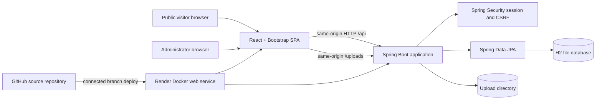
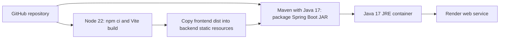
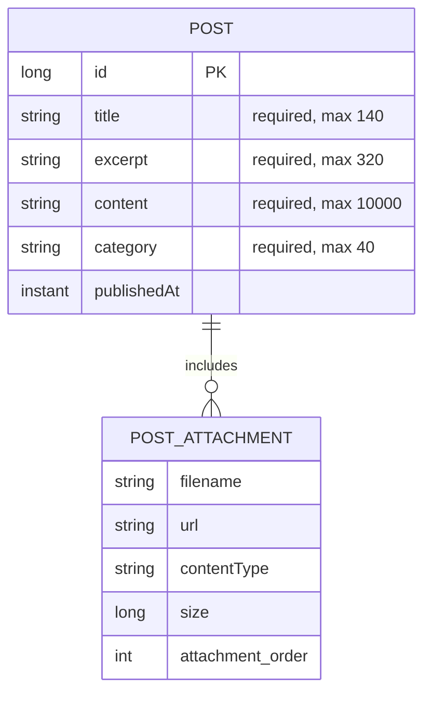
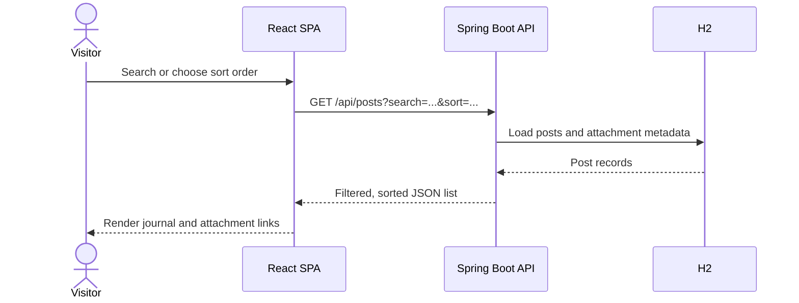
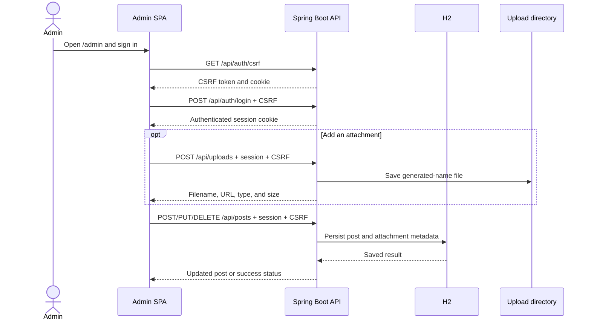

# Software/System Design Document

## 1. Purpose

This document describes the design of the personal portfolio and journal website in this repository. It is intended for maintainers who need to understand its components, data, interfaces, security boundaries, and deployment model.

## 2. Scope and users

The application has two user-facing areas:

- **Public visitor:** browses the portfolio, resume, social links, and journal. Visitors can search and sort posts and open post attachments.
- **Administrator:** signs in at `/admin` and creates, edits, and deletes journal posts, uploads attachments, and edits the resume.

The implementation is a single-admin application. It does not currently provide public registration, multiple administrator accounts, comments, or a separate content-moderation workflow.

## 3. Requirements

### Functional requirements

1. Present a portfolio profile, project links, social profile links, and a resume link.
2. Display journal posts and their optional document/image attachments.
3. Filter journal posts by a text term and sort by newest, oldest, or title.
4. Let the visitor switch between light and dark themes; retain the theme choice in browser local storage.
5. Require administrator authentication for post mutations, file uploads, and resume updates.
6. Permit visitors to read posts and retrieve linked uploads without signing in.
7. Expose a health endpoint for deployment checks.
8. Let the administrator maintain a structured resume, with two public print layouts (with or without a photo) and browser print-to-PDF support.
9. Display the frontend application version on the portfolio and resume pages.

### Non-functional requirements and constraints

- The frontend and API are served from one origin in the production Docker image.
- The frontend is a React SPA built with Vite; development uses the Vite server.
- The backend uses Java 17, Spring Boot, Spring MVC, Spring Security, Spring Data JPA, and H2.
- Posts, resume data, and attachment metadata are persisted in H2; uploaded file bytes are stored on the server filesystem.
- The current Render Blueprint uses a free web service with no persistent disk. Its database and uploads are therefore not durable across service lifecycle events.
- Upload size is limited to 10 MiB and accepted extensions are PDF, DOC, DOCX, TXT, MD, PNG, JPG/JPEG, GIF, and WEBP.

## 4. System context and architecture

In production, the frontend build output is copied into Spring Boot's static-resource directory and packaged into the executable JAR. Spring Boot serves both the static SPA and API. In local development, Vite serves the frontend separately and calls the API using relative URLs; the backend allows the local Vite origins configured in `WebConfig`.

### Build and deployment pipeline

The pipeline is implemented in the root `Dockerfile`. The Render Blueprint declares the Docker service, free plan, `/api/health` check, admin username, and a private `ADMIN_PASSWORD` prompt.

## 5. Component responsibilities

| Component | Responsibility |
|---|---|
| `frontend/src/App.jsx` | Public portfolio, journal, search/sort controls, theme toggle, and visitor-facing resume/social links. |
| `frontend/src/Admin.jsx` | Admin login state, post/attachment management UI, and resume editor. |
| `frontend/src/ResumePage.jsx` | Public resume, template selection, application version, and print action. |
| `frontend/src/data.js` | Editable profile, social/project links, and local sample content. |
| `backend/.../post/PostController.java` | Public post listing and authenticated post create/update/delete endpoints. |
| `backend/.../upload/UploadController.java` | Authenticated upload validation, storage, and upload metadata response. |
| `backend/.../auth/AuthController.java` | CSRF token, login, and current-session endpoints. |
| `backend/.../config/SecurityConfig.java` | Password encoder, authorization policy, CSRF, session, and logout configuration. |
| `backend/.../post/PostRepository.java` | JPA persistence and eager attachment retrieval for post reads. |
| `backend/.../post/SamplePostLoader.java` | Adds example posts only when the database contains no posts. |
| `backend/.../resume/ResumeController.java` | Public resume reads and authenticated resume updates. |
| `backend/.../resume/ResumeData.java` | Validated resume fields and standard experience/education/project sections. |
| `backend/.../config/HealthController.java` | Returns the health status used by Render. |
| `backend/.../config/AdminPageController.java` | Serves the SPA for `/admin` and `/admin/`. |

## 6. Data design

`Post` is a JPA entity stored in the `posts` table. Its attachment metadata is an ordered element collection stored in `post_attachments`. The file contents are separate filesystem objects; each post stores an `/uploads/...` URL and display metadata. The current H2 schema is maintained with Hibernate `ddl-auto=update`; no versioned database migration tool is configured.

The current resume is stored as one validated `ResumeData` JSON document in the `resume_document` table. It contains contact/profile fields, optional photo URL, skills, experience, education, projects, certifications, and languages. The portrait bytes use the existing upload directory. When no resume row exists, `GET /api/resume` returns the supplied profile details as an editable starter resume.

## 7. HTTP API

All API paths are relative to the application origin. JSON errors and HTTP status codes are returned by Spring MVC/Security.

| Method and path | Access | Purpose |
|---|---|---|
| `GET /api/health` | Public | Health response, `{"status":"ok"}`. |
| `GET /api/posts?search=&sort=newest` | Public | List posts; search title, excerpt, body, and category. `sort` accepts `newest`, `oldest`, or `title`; unsupported values return 400. |
| `GET /api/resume` | Public | Retrieve the structured resume used by the print page. |
| `PUT /api/resume` | Admin, CSRF-protected | Validate and persist resume fields and sections. Resume links must use HTTP or HTTPS; portrait URLs must refer to an uploaded image. |
| `GET /api/auth/csrf` | Public | Obtain a CSRF token before a state-changing request. |
| `GET /api/auth/me` | Public | Report whether the current session is authenticated. |
| `POST /api/auth/login` | Public, CSRF-protected | Authenticate configured admin username/password and establish a session. |
| `POST /api/auth/logout` | Authenticated, CSRF-protected | Clear the authenticated session. Successful logout returns 204. |
| `POST /api/posts` | Admin, CSRF-protected | Create a post with title, excerpt, content, category, and attachment metadata. |
| `PUT /api/posts/{id}` | Admin, CSRF-protected | Replace editable post fields and attachment metadata. |
| `DELETE /api/posts/{id}` | Admin, CSRF-protected | Delete a post. Returns 204 on success. |
| `POST /api/uploads` | Admin, CSRF-protected | Upload a multipart `file`; returns filename, URL, content type, and size. |
| `GET /uploads/{filename}` | Public | Retrieve uploaded content linked by a post. |

Post field limits and attachment URL shape are validated by the backend request records. Uploads are checked for empty input, 10 MiB maximum size, and an allowed filename extension. The extension allowlist is not a malware scan or a guarantee that the uploaded bytes match the declared content type.

## 8. Main request flows

### Public journal read

### Admin write

## 9. Security design

- The admin username and password are read from environment-backed application properties. Startup fails if the username is blank or the password is shorter than 12 characters.
- The password is encoded with BCrypt before being placed in the in-memory Spring Security user store; credentials are not stored in the JPA database.
- Login uses a session cookie. The configured cookie is HTTP-only, SameSite=Lax, and can be marked Secure with `SESSION_COOKIE_SECURE`; Render sets it to `true`.
- CSRF protection is enabled. The frontend retrieves a CSRF token and sends it for write, upload, login, and logout requests.
- `GET /api/posts`, health, auth bootstrap/session endpoints, and `/uploads/**` are public. Other `/api/**` requests require authentication.
- Uploaded attachments are intentionally publicly retrievable; do not upload private or sensitive files.
- The current application does not implement rate limiting, virus scanning, multi-factor authentication, or an external identity provider.

## 10. Configuration and source map

| Setting | Purpose | Default/current deployment |
|---|---|---|
| `PORT` | HTTP listener port | Spring default 8080; supplied by hosting platform. |
| `ADMIN_USERNAME` | Single admin account name | Blueprint value `Admin`. |
| `ADMIN_PASSWORD` | Single admin password | Must be supplied privately; at least 12 characters. |
| `SESSION_COOKIE_SECURE` | Set Secure on session and CSRF cookies | `false` locally by default; `true` in Render Blueprint. |
| `DATA_DIR` | Parent directory for H2 file database | `./data`. |
| `UPLOAD_DIR` | Directory for uploaded bytes | `./uploads`. |

The principal source files are under `frontend/src/` and `backend/src/main/java/com/personal/website/`. Build and hosting configuration lives in `frontend/package.json`, `backend/pom.xml`, `Dockerfile`, and `render.yaml`.

## 11. Known design limitations

- The current free Render service has ephemeral storage and provides no durable backup for H2 or uploads.
- Resume details are stored in the same ephemeral H2 database on the current free service; they can be lost alongside posts on restart/redeploy.
- Post deletion does not currently remove the corresponding uploaded file, so unreferenced files may remain on disk.
- Sample portfolio links and contact details in `frontend/src/data.js` are placeholders and must be personalized before public use.
- H2 is appropriate for this small personal site, but should be replaced or externally managed for higher availability, concurrent workloads, or stronger data lifecycle controls.
